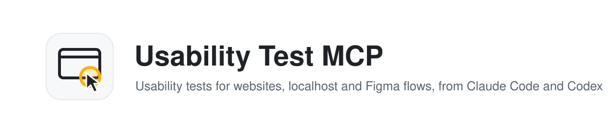
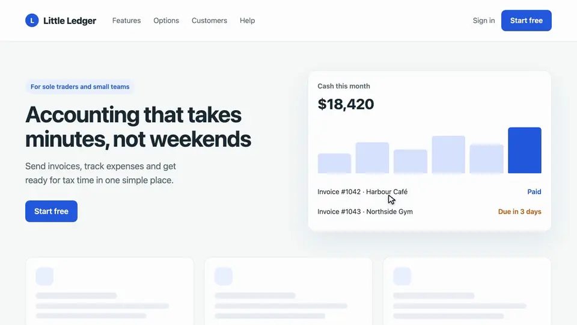
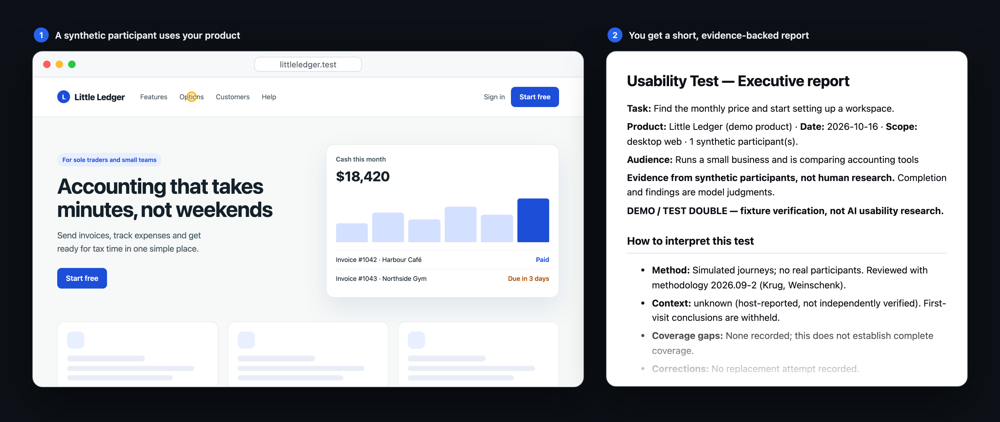
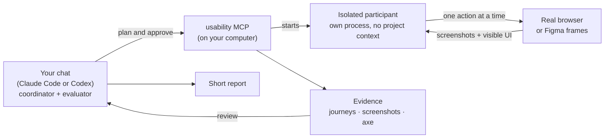
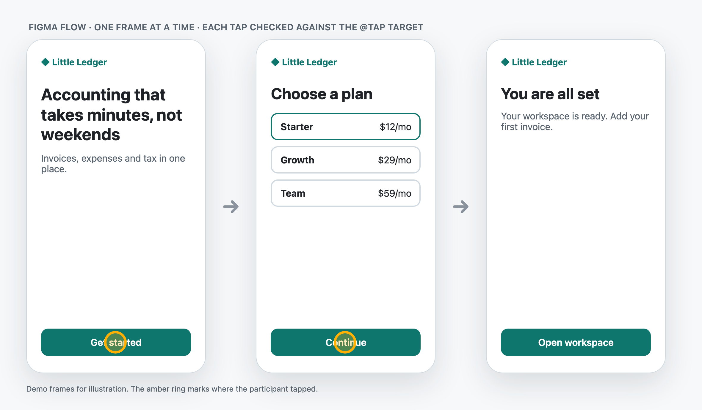

<picture>
  <source media="(prefers-color-scheme: dark)" srcset="docs/assets/banner-dark.svg">
  
</picture>

<p align="center">
  <b>Run usability tests on your website, localhost or Figma flows, right from Claude Code or Codex.</b><br>
  Synthetic participants use a real browser. You get a short, evidence-backed report with concrete fixes.
</p>

<p align="center">
  <a href="COMMERCIAL.md"></a>
  <a href="https://github.com/gabrielhidalgow/usability-test-mcp/releases"></a>
  
  <a href="https://modelcontextprotocol.io"></a>
  
  
</p>

<p align="center">
  <a href="#quick-start">Quick start</a> ·
  <a href="#what-you-get">What you get</a> ·
  <a href="#how-it-works">How it works</a> ·
  <a href="#faq">FAQ</a> ·
  <a href="#docs">Docs</a>
</p>

<p align="center">
  
  <br><sub>A participant working through the built-in demo product: one issue found, task completed. Animated from real screenshots of the demo; not real research.</sub>
</p>

## Highlights

- 🚀 **One command to install.** It sets up the MCP and a `/usability-test` command for Claude Code and Codex.
- 🧭 **Guided setup.** It scans your product, drafts the plan with sources, and asks you only what it can't know.
- 🧪 **Clean participants.** Each one runs as its own isolated process, without your project files, memory or other tools.
- 🌐 **Test almost anything:** live sites, localhost, Figma links and (experimental) native apps.
- 📝 **Reports you can act on.** At most three fixes, with the exact copy or design change and a screenshot for each.
- 🔑 **No API keys.** It runs on your existing Claude or ChatGPT subscription; there is nothing extra to pay.

## Quick start

**1. Install** (Node 22+; macOS, Linux or Windows):

```bash
npx --yes github:gabrielhidalgow/usability-test-mcp setup --host claude-code,codex
```

Use `--host claude-code` or `--host codex` if you only use one. Then restart Claude Code or Codex.

**2. Run a test** from any project. In Claude Code:

```text
/usability-test https://your-site.com
/usability-test http://localhost:3000
/usability-test https://www.figma.com/design/<file>/<name>?node-id=1-2
```

In Codex the same command is `/prompts:usability-test …`.

Add a goal in plain words if you like, for example `… find the monthly price`. With no arguments, it asks what you want to test.

**3. What happens next:**

1. It checks for updates and makes sure a clean participant can start.
2. It scans the visible pages and drafts the setup: audience, journey and success criteria. You edit and approve.
3. A participant works through the task in a visible Chromium window. You can watch.
4. Your chat reviews the screenshots and records evidence-linked findings.
5. You get a short report with its path, plus what to trust and what not to.

More options: [docs/INSTALL.md](docs/INSTALL.md).

## What you get

A short `report.md` for decisions and a full `details.md` with every step, screenshot and limitation.



<details>
<summary>Report outline</summary>

1. **At a glance:** task, scope, completion and a participant table.
2. **Recommended actions:** at most three, most serious first, each with screenshot evidence.
3. **Concrete changes:** the screen, the proposed copy or design change (current → proposed), and how to check it in a retest.
4. **What worked:** things to keep.
5. **Evidence limits and next check.**

See [a full demo report](docs/assets/demo-report.png) and [docs/REPORT_TEMPLATE.md](docs/REPORT_TEMPLATE.md).
</details>

The images above come from the built-in demo product and a deterministic test participant (`npm run readme-assets`), not real research.

## How it works



Your chat is the coordinator: it sets up the test and evaluates the evidence afterwards. Participants never run in that chat, because it knows your code, your memory and your other tools. Each participant runs as **its own headless Claude Code or Codex process**, sees only the screen, its profile and the task, and is checked for product knowledge before it starts. [More on clean participants](docs/CLEAN-PARTICIPANTS.md).

## Test anything

| Target | How | Notes |
| --- | --- | --- |
| 🌐 **Live website** | Any `https://` URL | Read-only by default; forms, payments and messages are blocked. |
| 💻 **Localhost** | `http://localhost:3000` with your dev server running | Your API should share the origin (one port or a dev proxy). |
| 🎨 **Figma flow** | A link to a section, page or file | Uses the official Figma MCP (two calls per flow), or a PNG export on any plan. [Guide](docs/FIGMA.md) |
| 📱 **Native app** *(experimental)* | An app ID such as `com.example.app` | Needs Maestro and a prepared simulator or emulator. [Guide](docs/NATIVE.md) |



You can also narrow a test to one feature or page (**focus areas**), compare three participants, save a plan and rerun it, or retest after a fix. See [docs/PROJECTS.md](docs/PROJECTS.md).

## The method

The tests follow a small, versioned method adapted from Steve Krug (*Don't Make Me Think*, *Rocket Surgery Made Easy*) and Susan Weinschenk (*100 Things Every Designer Needs to Know About People*):

- realistic tasks that don't give away the route;
- participants think aloud and say what they expect each action to do;
- at most three fixes, most serious first, each backed by evidence.

See [docs/METHODOLOGY.md](docs/METHODOLOGY.md).

## What it is not

- **Not real users.** Participants are AI agents. Use the findings to spot likely problems early, then confirm the important ones with people.
- **Not a score.** There is no usability score or statistical claim.
- **Not a WCAG audit.** axe checks and keyboard journeys find some issues; they do not certify conformance.

See [docs/SAFETY.md](docs/SAFETY.md) for browser safety and limits.

## FAQ

<details>
<summary><b>What does it cost?</b></summary>

It's free for personal and noncommercial use. Using it at work (for a company, clients or a product) needs a [one-time commercial licence](COMMERCIAL.md) of US$49 per company.

Running tests uses the Claude or ChatGPT subscription you already have with Claude Code or Codex, with no API keys and no separate billing. Tests count towards your plan's normal usage.
</details>

<details>
<summary><b>Where does my data go?</b></summary>

The browser, evidence and reports stay on your computer (`~/.local/share/usability-mcp/artifacts/`, or `%LOCALAPPDATA%\usability-mcp\artifacts` on Windows). Screenshots and visible text go to your connected chat for reasoning, as with anything else you share with it. Source code is never sent.
</details>

<details>
<summary><b>Does Figma testing work on a free plan?</b></summary>

Yes. With the official Figma MCP each flow takes two calls (free plans get about 20 a month). Without it, or for any file you can view, export the section as PNG and test that. See [docs/FIGMA.md](docs/FIGMA.md).
</details>

<details>
<summary><b>It says the CLI is not logged in.</b></summary>

Participants run through the `claude` or `codex` command-line tool, which has its own login. Run `claude /login` or `codex login` in a terminal once.
</details>

<details>
<summary><b>How do I update or uninstall?</b></summary>

`/usability-test` updates itself when a new version is out. To remove everything except your reports, run `npx --yes github:gabrielhidalgow/usability-test-mcp uninstall`. See [docs/INSTALL.md](docs/INSTALL.md).
</details>

<details>
<summary><b>Can I use it with another MCP host?</b></summary>

Yes, as long as it runs local MCP servers and accepts image results: `setup --host manual` prints the configuration. Claude Desktop is supported with `--host claude-desktop`. Clean, isolated participants need the Claude Code or Codex CLI.
</details>

## Docs

| Guide | What's inside |
| --- | --- |
| [Install, update and remove](docs/INSTALL.md) | Hosts, manual configuration, troubleshooting |
| [Guided setup and projects](docs/PROJECTS.md) | Questionnaire, focus areas, three participants, retests |
| [Figma flows](docs/FIGMA.md) | Links, `@tap` targets, free-plan fallback |
| [Clean participants](docs/CLEAN-PARTICIPANTS.md) | How isolation works and what it can't guarantee |
| [Methodology](docs/METHODOLOGY.md) | Principles, sources and limits |
| [Reference](docs/REFERENCE.md) | MCP tools, prompts, resources, report format |
| [Safety and limits](docs/SAFETY.md) | Browser policy, blocked requests, privacy |
| [Native apps](docs/NATIVE.md) | Experimental Maestro adapter |

## About

Made by [Gabriel Hidalgo](https://gabrielhidalgo.design/), a product designer. I built it to get quick usability feedback on live sites, local builds and Figma flows without leaving my chat, and to keep that feedback honest about what synthetic participants can and can't tell you.

[gabrielhidalgo.design](https://gabrielhidalgo.design/) · [X @ghidalgodesign](https://x.com/ghidalgodesign) · [GitHub](https://github.com/gabrielhidalgow)

If it saves you time, you can [buy me a coffee ☕](https://buy.stripe.com/eVq7sK0Gtcf3ezFgB087K03).

## Contributing

Issues and pull requests are welcome. See [CONTRIBUTING.md](CONTRIBUTING.md). Run `npm run check` before opening a PR.

## Licence and pricing

- **Free** for personal projects, learning, research and non-profits ([PolyForm Noncommercial 1.0.0](LICENSE)).
- **Using it at work** (a company, client work, or inside a product or service) needs a [commercial licence](COMMERCIAL.md): [US$49 one-time per company](https://buy.stripe.com/aFabJ0ah3cf33V1acC87K02).
- Versions up to and including v0.14.x were released under MIT and remain MIT.

© 2026 Gabriel Hidalgo
